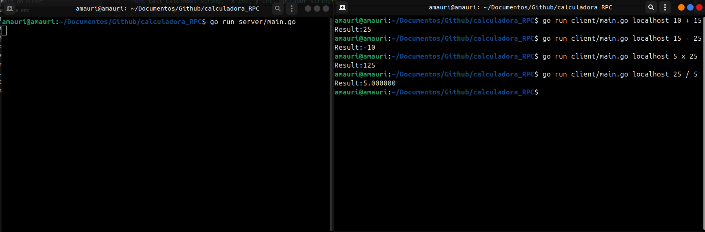

# Calculadora RPC

Calculadora cliente-servidor em **Go** usando o pacote nativo `net/rpc`. O servidor expõe as quatro operações por RPC via TCP, e o cliente de linha de comando chama a operação remotamente.



## Como funciona

```
client/main.go  ──── RPC (TCP :1234) ────▶  server/main.go
                                                  │
                                                  ▼
                                        operations.Calculadora
                                          ├─ Soma
                                          ├─ Subtracao
                                          ├─ Multiplicacao
                                          └─ Divisao
```

Os tipos de requisição e resposta (`Numbers`, `ResultadoInt`, `ResultadoFloat`) ficam no pacote `calc`, compartilhado entre cliente e servidor.

## Tecnologias

- Go (somente biblioteca padrão: `net`, `net/rpc`)

## Como rodar

Em um terminal, suba o servidor:

```bash
git clone https://github.com/JoseAmauriOP/calculadora_RPC.git
cd calculadora_RPC
go run ./server
```

Em outro terminal, chame o cliente:

```bash
go run ./client <host> <x> <operador> <y>
```

```bash
go run ./client localhost 10 + 5    # Result:15
go run ./client localhost 10 - 5    # Result:5
go run ./client localhost 10 x 5    # Result:50
go run ./client localhost 7 / 2     # Result:3.500000
```

| Operador | Método RPC | Retorno |
|---|---|---|
| `+` | `Calculadora.Soma` | `int` |
| `-` | `Calculadora.Subtracao` | `int` |
| `x` | `Calculadora.Multiplicacao` | `int` |
| `/` | `Calculadora.Divisao` | `float64` |

A multiplicação usa `x` em vez de `*` porque o terminal interpreta o `*` como curinga de arquivos.

## Tratamento de erros

- Divisão por zero é recusada pelo servidor, que devolve um erro para o cliente.
- Operandos que não são números inteiros e operadores desconhecidos são rejeitados pelo cliente antes de chamar o servidor.

## Estrutura

```
calculadora_RPC/
├── calc/          # tipos compartilhados entre cliente e servidor
├── client/        # cliente de linha de comando
├── operations/    # Calculadora e suas operações, um arquivo por operação
├── server/        # servidor RPC
└── go.mod
```

## O que aprendi

- Como funciona uma chamada de procedimento remoto: o cliente chama um método como se fosse local, e ele roda no servidor
- Registrar um tipo com `rpc.Register` e aceitar conexões TCP com `net.Listen` e `rpc.Accept`
- As regras que o `net/rpc` exige dos métodos expostos (dois argumentos, o segundo é ponteiro, retorno `error`)
- Devolver erros do servidor para o cliente pela própria chamada RPC
- Organizar um projeto Go em pacotes

## Próximos passos

- [ ] Testes unitários das operações
- [ ] Aceitar números decimais nas quatro operações

---

Desenvolvido por [José Amauri Patrício](https://www.linkedin.com/in/amauri-patricio-5a121435b) · Licença MIT
